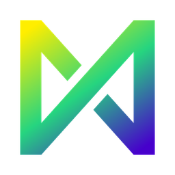

# David
[Português (Brasil)](README.pt-BR.md)

A free raster paint program for Windows and Linux, inspired by Paint.NET's simple layout. It adds pixel-art and animation tools, can be extended with mods, and comes in English and Brazilian Portuguese.

**[Download the Windows installer](https://github.com/YuriShimoi/david/releases/latest/download/david-1.2.0-setup.exe)** (v1.2.0, 6 MB, no admin rights needed)

Other downloads are on the [release page](https://github.com/YuriShimoi/david/releases/latest):

| File | For |
|---|---|
| `david-1.2.0-setup.exe` | Windows 10/11 installer (8.1 best effort) |
| `david-1.2.0-win64-portable.zip` | Windows portable: unzip and run `david.exe` |
| `David-1.2.0-x86_64.AppImage` | Linux, one file: `chmod +x` and run |
| `david-1.2.0-linux-x86_64.tar.gz` | Linux: unpack and run `david` |

## What it has
- **Common tools**: selections, move and transform, brush, pencil, eraser, bucket, picker, gradient, line and curve, shapes, text, layers with blend modes, unlimited history.
- **Pixel art**: tiled mode, pixel-perfect lines, symmetry, grid with snapping, outline, autotile, palettes, shading.
- **Animation**: timeline, onion skin, tags, export to GIF, APNG, WebP and sprite sheets.
- **Adjustments and effects** with live preview, including dither.
- **Themes**: dark and light, plus your own, edited live.
- **Vector layers** (beta, turned on in Settings > Beta tools): shapes, paths and text as objects, sharp at any zoom, with object and node tools, SVG import and export, and an exact pixel-art trace.
- **Mods**: shader, Lua and native C mods, with a built-in modding guide (Help > Modding guide).
- **Command line**: `david-cli` for batch conversion, effects and animations.
- **Files**: `.david`, OpenRaster, PNG/APNG, JPEG, BMP, TGA, GIF, WebP, SVG.

## Building
C++20, CMake, Ninja and vcpkg. Windows: `build.cmd win-release`. Linux: `VCPKG_ROOT=~/vcpkg cmake --preset linux-release && cmake --build --preset linux-release`. Packages: `python tools/package.py win|linux`.

## License
MIT, see [LICENSE](LICENSE).
David uses SDL3, Dear ImGui, glad, GLM, libpng, zlib, libwebp, stb, FreeType, HarfBuzz, Fontconfig (Linux), Lua with sol2, nlohmann/json, CLI11, ThorVG and pugixml, each under its own license. Icons: Font Awesome Free (SIL OFL 1.1), Tabler Icons and Phosphor Icons (MIT), licenses in `assets/fonts/`.
