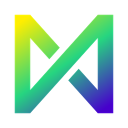

# David
[English](README.md)

Um programa gratuito de pintura para Windows e Linux, inspirado no layout simples do Paint.NET. Ele traz ferramentas de pixel art e animação, pode ser estendido com mods e está disponível em inglês e português do Brasil.

**[Baixar o instalador para Windows](https://github.com/YuriShimoi/david/releases/latest/download/david-1.2.1-setup.exe)** (v1.2.1, 6 MB, não precisa de administrador)

Os outros downloads estão na [página de releases](https://github.com/YuriShimoi/david/releases/latest):

| Arquivo | Para |
|---|---|
| `david-1.2.1-setup.exe` | Instalador para Windows 10/11 (8.1 sem garantia) |
| `david-1.2.1-win64-portable.zip` | Windows portátil: descompacte e rode o `david.exe` |
| `David-1.2.1-x86_64.AppImage` | Linux, um só arquivo: `chmod +x` e rode |
| `david-1.2.1-linux-x86_64.tar.gz` | Linux: descompacte e rode o `david` |

## O que ele tem
- **Ferramentas comuns**: seleções, mover e transformar, pincel, lápis, borracha, balde de tinta, conta-gotas, gradiente, linha e curva, formas, texto, camadas com modos de mesclagem, histórico ilimitado.
- **Pixel art**: modo ladrilhado, linhas pixel perfeito, simetria, grade com encaixe, contorno, autotile, paletas, sombreamento.
- **Animação**: linha do tempo, papel vegetal, tags, exportação para GIF, APNG, WebP e sprite sheets.
- **Ajustes e efeitos** com prévia ao vivo, incluindo pontilhado.
- **Temas**: escuro e claro, além dos seus, editados ao vivo.
- **Camadas vetoriais** (beta, ativadas em Configurações > Ferramentas beta): formas, caminhos e texto como objetos, nítidos em qualquer zoom, com ferramentas de objeto e de nós, importação e exportação de SVG e um traçado exato de pixel art.
- **Mods**: mods de shader, Lua e C nativo, com um guia de mods embutido (Ajuda > Guia de mods).
- **Linha de comando**: `david-cli` para conversão em lote, efeitos e animações.
- **Arquivos**: `.david`, OpenRaster, PNG/APNG, JPEG, BMP, TGA, GIF, WebP, SVG.

## Compilação
C++20, CMake, Ninja e vcpkg. Windows: `build.cmd win-release`. Linux: `VCPKG_ROOT=~/vcpkg cmake --preset linux-release && cmake --build --preset linux-release`. Pacotes: `python tools/package.py win|linux`.

## Licença
MIT, veja [LICENSE](LICENSE).
O David usa SDL3, Dear ImGui, glad, GLM, libpng, zlib, libwebp, stb, FreeType, HarfBuzz, Fontconfig (Linux), Lua com sol2, nlohmann/json, CLI11, ThorVG, pugixml e Clipper2, cada um com sua própria licença. Ícones: Font Awesome Free (SIL OFL 1.1), Tabler Icons e Phosphor Icons (MIT), licenças em `assets/fonts/`.
